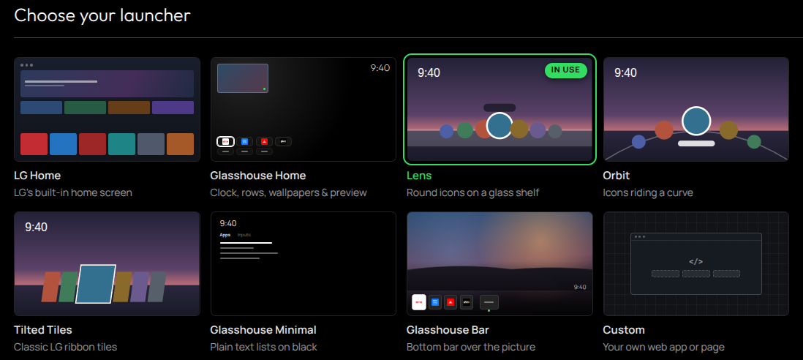
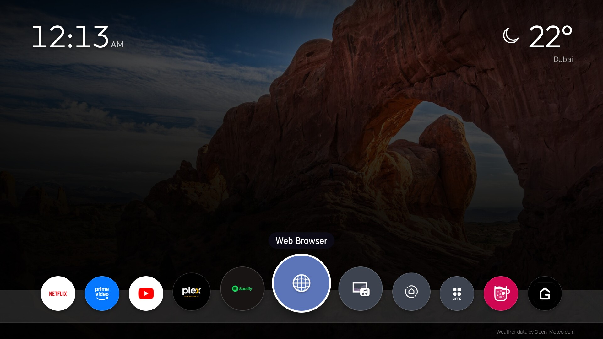
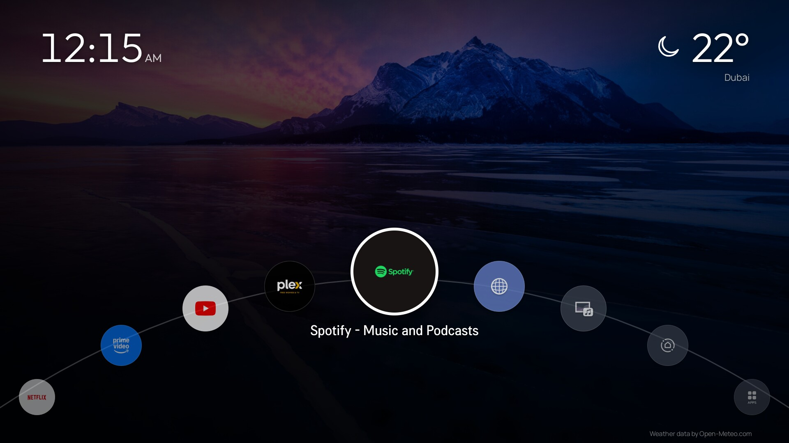
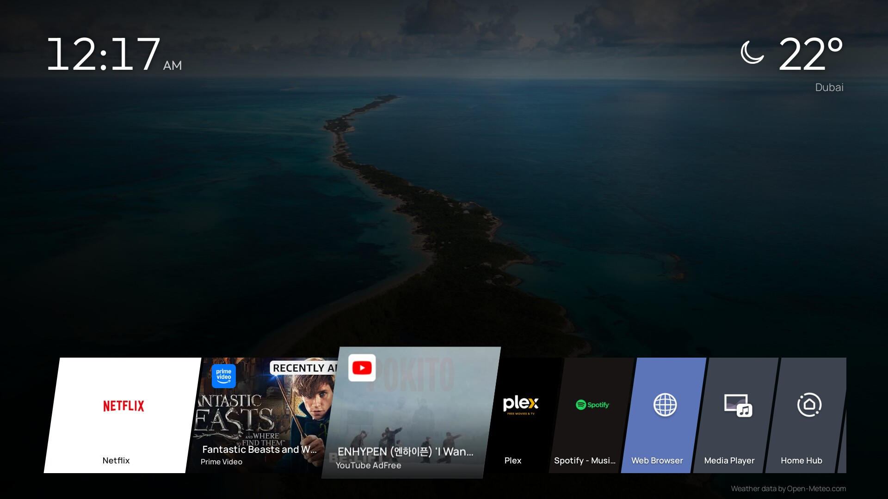

# Glasshouse Home styles

Three new looks for the Apps row of [Glasshouse](https://github.com/rorygallagher2024/glasshouse) Home on a rooted LG webOS TV, chosen from the Glasshouse dashboard like any other launcher:

- **Lens:** round icons on a frosted glass shelf across the screen. The app in focus and its neighbours swell as if under a magnifier.
- **Orbit:** round icons riding a gentle curve. The app in focus sits in the middle, biggest, with a white ring.
- **Tilted Tiles:** tall, tilted, coloured tiles like LG's classic webOS launcher. The tile in focus grows.

The **Glasshouse Home** card keeps Glasshouse's own tiles.



This is an unofficial add-on, not part of Glasshouse and not made by its developer. It patches Glasshouse Home's page and dashboard on the TV, so a Glasshouse update removes it until you run the installer again (see below).

## What else it changes

These come with every style, including Glasshouse's own tiles:

- **Clock and weather:** the time sits in the top-left corner, and the place and temperature in the top-right. The date and "Last opened" are hidden.
- **Idle screen:** after 30 seconds without a key press, the rows fade out, leaving the wallpaper, time and weather. The first key press, click or wheel turn only brings them back.
- **Live tiles:** Netflix, Prime Video and YouTube show their own Continue watching and Top picks pictures and titles. This needs **Recommended** switched on in Glasshouse, and only works for apps that share titles with the TV.
- **Colours:** each tile or circle takes the colour from the edge of its app's icon.
- **Magic Remote wheel:** in Lens and Orbit, each notch moves one app.
- **Own icons (optional):** you can replace an app's icon with a picture of your own (see [icons/README.md](icons/README.md)).
- **Bing wallpapers (optional):** `bing-wall.sh` downloads Bing's photo of the day into Glasshouse's shuffled wallpapers.

## Requirements

- An LG TV rooted with the Homebrew Channel, with SSH access as root.
- [Glasshouse](https://github.com/rorygallagher2024/glasshouse) installed, with Glasshouse Home switched on.
- Tested on one TV only (see [Tested on](#tested-on)). Other models and webOS versions have not been tried.

## Tested on

| | |
| --- | --- |
| TV | LG 55NANO776RA (55", NanoCell) |
| webOS | webOS TV Lite 10.3.2 (build 33, August 2026) |
| Firmware | 33.31.75 |

If it works, or doesn't, on another model, please open an issue with the model and webOS version.

## Install

1. Download this repository, for example as a ZIP from the green **Code** button, and unzip it.
2. In that folder, run this, with your TV's address in place of `TV_IP`:

   ```sh
   tar cf - lg-tiles.sh lg-common.html lg-dash.html lg-style-lens.html lg-style-orbit.html lg-style-tilted.html icons \
     | ssh root@TV_IP "mkdir -p /home/root/lg-tiles && cd /home/root/lg-tiles && tar xf - && sh lg-tiles.sh"
   ```

   If you log in with a key, add `-i path/to/your/key` after `ssh`.
3. Open the Glasshouse dashboard (`http://TV_IP:8080/`), go to the **Home** tab and choose **Lens**, **Orbit** or **Tilted Tiles** under **Choose your launcher**.
4. Press **Home** on the remote.

Lens is used until you choose a style. To start with another one, end the command with `sh lg-tiles.sh orbit` or `sh lg-tiles.sh tilted` instead.

## After a Glasshouse update

An update replaces Glasshouse Home and the dashboard, so the styles and the three cards go away. The files stay on the TV, so one command puts everything back, and your chosen style is kept:

```sh
ssh root@TV_IP "sh /home/root/lg-tiles/lg-tiles.sh"
```

## Remove

```sh
ssh root@TV_IP "sh /home/root/lg-tiles/lg-tiles.sh remove"
```

This takes the changes out of Glasshouse Home and the dashboard. The installer also kept the unpatched pages from before its first run, as `home.html.before-lg-tiles` and `ui.html.before-lg-tiles` in `/var/lib/tvweb/assets/`.

## Bing wallpapers (optional)

```sh
scp bing-wall.sh root@TV_IP:/home/root/lg-tiles/
ssh root@TV_IP "sh /home/root/lg-tiles/bing-wall.sh install"
```

This fetches the last couple of weeks of Bing's photos now, checks for a new one every 6 hours, keeps the newest 30, and starts again after every restart. Pictures you uploaded yourself are left alone. Then, on the dashboard's **Home** tab, choose **Background → Pictures → Your own, shuffled**, and how often the picture changes.

To stop it and delete the Bing pictures, run `sh /home/root/lg-tiles/bing-wall.sh remove`. Bing's photos are for personal use as wallpaper.

## Settings in the files

- **Wide/live apps:** `WIDE` in `lg-common.html` lists the apps that get live pictures, and that are drawn double width in Tilted Tiles. They're listed by app ID.
- **Own icons:** `ICONS` in `lg-common.html` maps an app ID to its own icon file.
- **Sizes and spacing:** these are at the top of the script in `lg-style-lens.html` and `lg-style-orbit.html`.

After changing a file, copy it to `/home/root/lg-tiles/` on the TV and run `sh lg-tiles.sh` there.

## How it works

`lg-tiles.sh` adds the contents of `lg-common.html` and the three style files to Glasshouse Home's page (`home.html`), and `lg-dash.html` to the dashboard (`ui.html`). Each addition sits between `lg-tiles:start` and `lg-tiles:end` markers, so running the installer again replaces it rather than adding a second copy. It then restarts the Glasshouse server and closes Glasshouse Home's page, so the next Home press loads the new copy.

The chosen style is saved in Glasshouse's own settings, so it survives restarts and updates.

## Screenshots

**Lens**



**Orbit**



**Tilted Tiles**



## License

MIT, see [LICENSE](LICENSE). Glasshouse itself is MIT-licensed, by Rory Gallagher.
